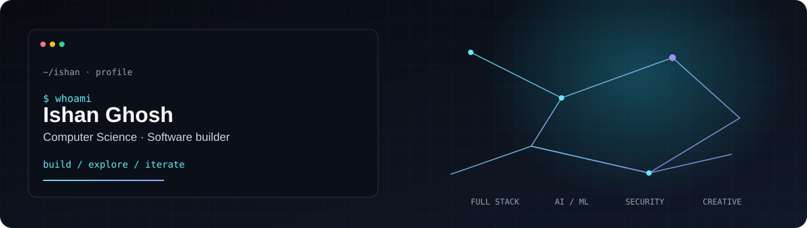

<!-- PROFILE README · CONTENT-FIRST EDITORIAL VERSION -->

  

[Portfolio](https://portfolio-ishang.vercel.app/) · [LinkedIn](https://www.linkedin.com/in/ishan-ghosh-7b33a4336/) · [Email](mailto:ishan.ghosh2004@gmail.com)

---

I'm **Ishan** — a Computer Science student and software builder interested in the intersection of **full-stack engineering, AI, security tooling and creative technology**.

I like taking an idea from a rough sketch to something that works: designing the interface, connecting the systems behind it, automating the repetitive parts, and figuring out the details that make the experience feel complete.

<strong>A little more about me</strong>

- 🎓 Computer Science, KIIT University · 2027
- 🧰 Experience across enterprise software, full-stack product development, ML workflows and computer vision
- 🧪 I learn by building experiments—not just collecting frameworks
- 🎞️ Outside code: cinema, music, editing, VFX, animation and visual design

---

## Things I've been building

A selection of projects across different problems and disciplines—not a list of every repository.

### 01 · Application security

<a href="https://github.com/IshanG2111/ARVE"><strong>ARVE — Adaptive Remediation & Verification Engine ↗</strong></a>

A security-analysis workflow that brings scanner findings, source-code context and remediation reporting together. Built around isolated scanner execution, finding normalization, code intelligence and a unified analysis experience.

Python · FastAPI · React · TypeScript · PostgreSQL · Docker · Celery

---

### 02 · Learning through interaction

<a href="https://github.com/IshanG2111/EcoQuest"><strong>EcoQuest ↗</strong></a> · <a href="https://ecoquest-woad.vercel.app/">Live experience ↗</a>

A gamified sustainability-learning experience—using an interactive world, progression and playful interface design to make learning feel exploratory.

Next.js · TypeScript · Firebase · UI engineering

---

### 03 · Machine learning & earth observation

<a href="https://github.com/IshanG2111/RainFall-Prediction-Model-"><strong>वृष्टि AI / Rainfall Prediction ↗</strong></a>

An experimental rainfall-prediction workflow using INSAT-3DR satellite-derived features, data processing and machine-learning models to explore short-term precipitation prediction.

Python · ML · Satellite data · Model evaluation

---

### 04 · Creative computing

<a href="https://github.com/IshanG2111/DREAMSCAPE"><strong>DREAMSCAPE ↗</strong></a>

A cinematic lyric-wallpaper experiment where typography, generative imagery, motion and audio become part of a visual composition.

Creative coding · Generative visuals · Audio-reactive design

---

### 05 · Developer automation

<a href="https://github.com/IshanG2111/leetcode-auto-sync"><strong>LeetCode → Notion automation ↗</strong></a>

A workflow for synchronizing coding activity and structured problem-solving records—reducing manual tracking and keeping a learning system organized.

Automation · APIs · TypeScript / JavaScript

---

## What I gravitate toward

| | |
|---|---|
| **Full-stack systems** | Product interfaces, APIs, authentication, data and end-to-end workflows |
| **AI & machine learning** | Applied ML, model-backed features, data pipelines and evaluation |
| **Security engineering** | Dependency analysis, static analysis, secrets and contextual remediation |
| **Creative technology** | Interactive 3D, generative visuals, computer vision and unusual interfaces |

## Tools I use

 

Tools are a means, not the point. I pick up technologies as the project needs them.

---

## Experience

- **Tata Motors** — software engineering internship experience working on supplier / procurement collaboration software.
- **Tata Cummins** — software engineering internship experience building document-viewer applications deployed across enterprise screens.

This is a short overview; the details belong on my portfolio and résumé.

---

## Elsewhere

- 🌐 [Portfolio](https://portfolio-ishang.vercel.app/)
- 💼 [LinkedIn](https://www.linkedin.com/in/ishan-ghosh-7b33a4336/)
- ✉️ [Email](mailto:ishan.ghosh2004@gmail.com)

I'm interested in how software works—and in making the things I build feel worth using.

